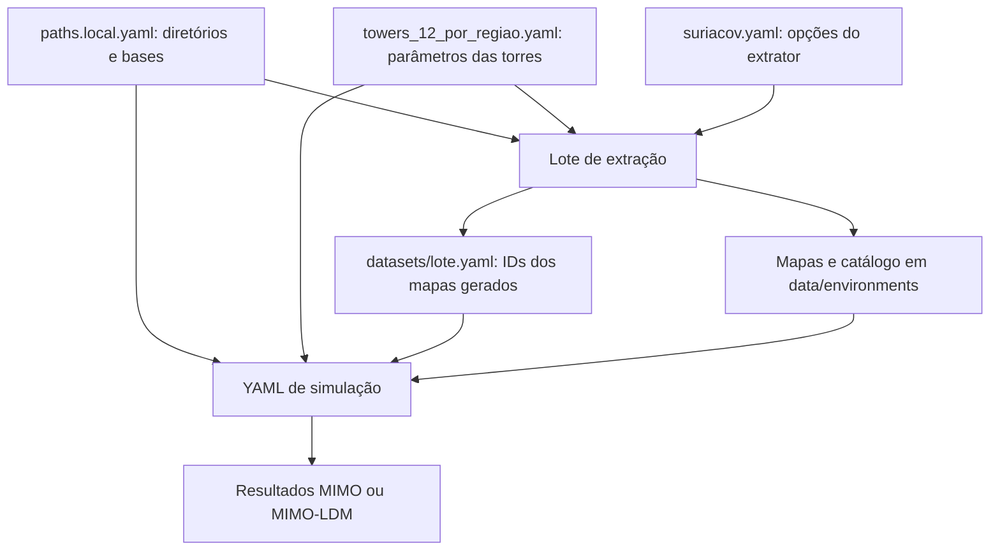

# Guia de configuração e execução

Este documento descreve os campos efetivamente usados pelo código deste projeto. A campanha atual contém **48 estações: 12 no Norte, Nordeste, Centro-Oeste e Sudeste**. O Sul está excluído. As alturas cadastradas são preservadas; o limiar da seleção é 70 m, com a exceção de 55 m no Nordeste.

Para começar, siga a seção [Primeira execução](#1-primeira-execução). Para consultar um parâmetro, procure seu nome neste arquivo com `Ctrl+F`.

## Índice

1. [Primeira execução](#1-primeira-execução)
2. [Como os arquivos se conectam](#2-como-os-arquivos-se-conectam)
3. [Caminhos e bases geográficas](#3-caminhos-e-bases-geográficas)
4. [Cadastro das torres](#4-cadastro-das-torres)
5. [Lotes de extração](#5-lotes-de-extração)
6. [Opções internas do SuriaCov](#6-opções-internas-do-suriacov)
7. [Seleção de datasets](#7-seleção-de-datasets)
8. [Configuração das simulações](#8-configuração-das-simulações)
9. [Campanha completa ou por região](#9-campanha-completa-ou-por-região)
10. [Paralelismo, repetição e custo](#10-paralelismo-repetição-e-custo)
11. [Saídas e importação](#11-saídas-e-importação)
12. [Erros comuns](#12-erros-comuns)

## 1. Primeira execução

Há três exemplos prontos, que compartilham a mesma estação e frequência:

| Etapa | Arquivo | Exemplo |
|---|---|---|
| Extrair terreno, LoS e perdas | [extraction/exemplo_guia.yaml](configs/extraction/exemplo_guia.yaml) | Coari/AM, `AM_57dbac0ec1a75`, 273 MHz |
| Simular MIMO | [mimo_capacity/exemplo_guia.yaml](configs/simulations/mimo_capacity/exemplo_guia.yaml) | 60 dBm, 10 realizações |
| Simular MIMO-LDM | [mimo_ldm_capacity/exemplo_guia.yaml](configs/simulations/mimo_ldm_capacity/exemplo_guia.yaml) | 60 dBm, IR = 3 dB, ε = 0,05, 10 × 5 realizações |

Os exemplos mantêm a grade de 360 × 360. A extração ainda pode demorar: reduzir o número de realizações Monte Carlo não acelera essa primeira etapa. Os números pequenos de realizações servem para conhecer o fluxo, não para estabelecer convergência dos resultados.

### 1.1 Abrir o projeto no PowerShell

```powershell
cd Capacity-TV3
$pythonTV3 = (Resolve-Path '.\.venv\Scripts\python.exe').Path
& $pythonTV3 --version
```

Antes deste passo, clone o repositório, crie `.venv`, instale `.[preparation]` e execute `scripts/setup_project.py`, conforme o [README](README.md). Execute os comandos seguintes na mesma sessão. O operador `&` executa o interpretador guardado em `$pythonTV3`, sem ativar o venv. No Linux/macOS, substitua `& $pythonTV3` por `./.venv/bin/python`. Use Python 3.12 ou superior.

### 1.2 Preparar um ambiente determinístico

Primeiro confira a configuração:

```powershell
& $pythonTV3 scripts/prepare_environments.py --config configs/extraction/exemplo_guia.yaml --dry-run
```

Depois execute a extração:

```powershell
& $pythonTV3 scripts/prepare_environments.py --config configs/extraction/exemplo_guia.yaml
```

Ao concluir, o programa gera `configs/extraction/datasets/exemplo_guia.yaml`, contendo o identificador dos mapas preparados. Se já houver um conjunto idêntico e íntegro no catálogo, ele poderá ser reutilizado.

### 1.3 Executar MIMO

**Faça isso depois de concluir a extração.** Até o `dry-run` da simulação depende dos datasets existentes.

```powershell
& $pythonTV3 scripts/run_mimo_capacity.py --config configs/simulations/mimo_capacity/exemplo_guia.yaml --dry-run
& $pythonTV3 scripts/run_mimo_capacity.py --config configs/simulations/mimo_capacity/exemplo_guia.yaml
```

### 1.4 Executar MIMO-LDM

O MIMO-LDM usa os mesmos mapas determinísticos. Ele não depende de executar MIMO antes.

```powershell
& $pythonTV3 scripts/run_mimo_ldm_capacity.py --config configs/simulations/mimo_ldm_capacity/exemplo_guia.yaml --dry-run
& $pythonTV3 scripts/run_mimo_ldm_capacity.py --config configs/simulations/mimo_ldm_capacity/exemplo_guia.yaml
```

Os resultados desses exemplos ficam em `results/mimo_capacity/exemplo_guia/` e `results/mimo_ldm_capacity/exemplo_guia/`.

### O que `--dry-run` verifica?

| Comando | O que verifica | O que não executa |
|---|---|---|
| Preparação | Leitura dos YAMLs, seleção de torres, frequências, tamanho mínimo da grade e overrides | Não abre e valida todas as bases geográficas, não verifica a presença de mar/NoData, não calcula propagação e não gera datasets |
| Simulação | Configuração, referências de datasets, correspondência dos parâmetros, integridade dos mapas e contagem de tarefas | Não executa Monte Carlo nem grava resultados |

O `dry-run` da simulação pode levar algum tempo porque lê e confere os arquivos. A verificação geográfica das 48 estações foi feita na seleção; ela não é uma função automática do `dry-run` de extração.

## 2. Como os arquivos se conectam



Cada caminho relativo dentro de um YAML é resolvido **a partir da pasta desse YAML**. Por exemplo, `../../paths.local.yaml` em `configs/simulations/mimo_capacity/exemplo_guia.yaml` aponta para `configs/paths.local.yaml`.

Já os argumentos de linha de comando, como `--config configs/...`, partem da pasta atual do terminal. Os exemplos deste guia partem da raiz do projeto.

Use espaços para indentar, ponto decimal (`0.273`) e booleanos `true`/`false`. `null` é um valor especial, não a string `"null"`. Para caminhos Windows em YAML, prefira barras `/` ou aspas simples: `'C:\dados\arquivo.tif'`.

Os campos listados abaixo são os suportados pelo fluxo atual. Algumas seções rejeitam chaves desconhecidas; outras podem ignorá-las. Acrescentar uma chave arbitrária não cria uma funcionalidade.

## 3. Caminhos e bases geográficas

O setup cria `configs/paths.local.yaml` a partir do [modelo portável](configs/paths.example.yaml) e descompacta as [bases incluídas](data/geography/README.md). O arquivo local não é versionado e pode ser ajustado para outras pastas.

| Campo | Obrigatoriedade / valor atual | Função |
|---|---|---|
| `environments_root` | Obrigatório; `../data/environments` | Mapas determinísticos e `catalog.json` |
| `results_root` | Obrigatório; `../results` | Resultados das simulações |
| `work_root` | Obrigatório; `../.cache` | Trabalho temporário, configuração efetiva e estado da extração |
| `geography.radio_zone_grid_shp` | Obrigatório para extrair | Shapefile da grade de zonas radioclimáticas |
| `geography.brazil_terr_limits_shp` | Obrigatório para extrair | Limite territorial usado para validar o transmissor |
| `geography.clutter_ref_tif` | Obrigatório para extrair | Raster MODIS da classificação do ambiente |
| `geography.brazil_geotiff` | Obrigatório para extrair | Raster de elevação do terreno |

As três pastas-raiz precisam ser distintas e não podem estar contidas umas nas outras. As simulações usam os mapas já preparados e não precisam abrir os quatro arquivos geográficos. O modelo aponta para `data/geography/extracted/`; execute o setup antes da extração. Para usar outras bases, ajuste os quatro caminhos no YAML local e confira sua compatibilidade geográfica.

## 4. Cadastro das torres

Arquivo atual: [configs/towers_12_por_regiao.yaml](configs/towers_12_por_regiao.yaml). O topo é `towers`, seguido de um bloco por identificador.

```yaml
towers:
  AM_57dbac0ec1a75:
    proj_name: AM_57dbac0ec1a75
    id_estacao: 57dbac0ec1a75
    tx_latitude: -4.0975
    tx_longitude: -63.1505555555555
    tx_height_ov_ground: 86.14
    tx_power_kw: 1.0
    tx_ant_patt: {}
    tx_polarization_id: 1
    rx_height_ov_ground: 10.0
    field_th: 50.0
    excedance_perc: 50
    num_samples: 360
```

| Campo | Tipo / valores | Efeito |
|---|---|---|
| Chave da torre | Texto como `UF_código` | Identifica a torre nos lotes, mapas e resultados |
| `proj_name` | Obrigatório; igual à chave da torre | Nome do projeto do transmissor |
| `id_estacao` | Opcional no carregador; mantido no cadastro | Chave original para rastreabilidade |
| `tx_latitude`, `tx_longitude` | Obrigatórios; graus decimais | Localização do transmissor; o SuriaCov exige ponto dentro do limite territorial configurado |
| `tx_height_ov_ground` | Obrigatório; metros; extrator aceita 1 a 3000 | Altura da antena **acima do terreno**, não altitude em relação ao mar |
| `tx_power_kw` | Preservar `1.0` no cadastro atual | Referência documentada; o adaptador de extração passa **1 kW fixo**, independentemente deste campo |
| `tx_ant_patt` | Opcional; `{}` é o padrão usado | Diagrama por azimute; vazio significa isotrópico. Valores não vazios são ganhos lineares, convertidos por `10 log10`, não valores em dB |
| `tx_polarization_id` | Obrigatório; `1` horizontal, `2` vertical | Polarização usada na propagação |
| `rx_height_ov_ground` | Obrigatório; metros; atual `10.0` | Altura do receptor acima do terreno, usada na extração e na simulação |
| `field_th` | Obrigatório; dBµV/m; atual `50.0` | Limiar para avaliar cobertura por intensidade de campo; não define o tamanho da grade atual |
| `excedance_perc` | Obrigatório; percentual; atual `50` | Percentagem temporal de excedência usada no cálculo de propagação; faixa documentada de 1 a 50 |
| `num_samples` | Inteiro positivo; extração exige pelo menos `10`; atual `360` | Número de pontos por lado: `360` gera 129.600 pontos |

Um diagrama não vazio deve ter azimutes numéricos distintos, ordenáveis, cobrindo o ciclo de 0 a 360°, com pontos suficientes para a interpolação cúbica (pelo menos quatro). Preserve `{}` se não estiver trabalhando com um diagrama medido.

O campo `num_samples` altera a resolução, não a área: o código atual fixa a extensão em **±2° de latitude e longitude**, ou 4° × 4°. Não existe uma chave YAML de raio em quilômetros nesse fluxo.

**Compatibilidade:** o simulador compara o dicionário inteiro da torre com os parâmetros gravados na extração. Alterar ou acrescentar campos, inclusive metadados, pode tornar o dataset incompatível. Mantenha as informações descritivas adicionais no relatório de seleção. Se mudar altura, posição, polarização, receptor ou grade, prepare mapas compatíveis antes de simular.

## 5. Lotes de extração

Campanha atual: [configs/extraction/torres_12_por_regiao/todas.yaml](configs/extraction/torres_12_por_regiao/todas.yaml). Exemplo pequeno: [configs/extraction/exemplo_guia.yaml](configs/extraction/exemplo_guia.yaml).

| Campo | Obrigatoriedade / padrão | Função |
|---|---|---|
| `paths` | Obrigatório | Caminho do YAML de diretórios e bases |
| `tower_catalog` | Obrigatório | Caminho do cadastro das torres |
| `towers` | Lista obrigatória, não vazia, sem repetições | IDs que serão extraídos; todos precisam existir no cadastro |
| `frequencies_ghz` | Lista obrigatória, positiva e sem repetições | Frequências em GHz; `0.273` = 273 MHz. O extrator limita a faixa a 0,03–6 GHz |
| `suriacov_config` | Obrigatório para gerar mapas novos | Caminho de `suriacov.yaml` |
| `reuse_existing` | Opcional; padrão `true` | Reutiliza datasets com os mesmos parâmetros e integridade conferida. `false` recalcula; não é um comando para apagar os anteriores |
| `selection_output` | Obrigatório | YAML que receberá os IDs dos datasets, publicado ao concluir o lote |
| `extraction_overrides` | Opcional; padrão `{}` | Substituições temporárias dos parâmetros das torres, descritas abaixo |

O lote calcula todas as combinações de `towers × frequencies_ghz`. Para 48 estações e cinco frequências são 240 ambientes; para 12 estações são 60.

Somente quatro overrides são aceitos:

```yaml
extraction_overrides:
  num_samples: 60
  rx_height_ov_ground: 10.0
  field_th: 50.0
  excedance_perc: 50
```

Esse trecho é ilustrativo e não está aplicado aos exemplos prontos. Um dataset extraído com `num_samples: 60` não passa na validação de uma simulação cujo cadastro ainda declare `360`. Para um teste com outra grade, use uma cópia do cadastro com os mesmos parâmetros efetivos na extração e na simulação. A seleção atual foi verificada para a grade de 360 × 360.

O programa processa as extrações **em sequência**. Não há `max_workers` no YAML de extração. Execute os lotes separadamente, pois compartilham o catálogo.

Uma grade muito reduzida pode não amostrar nenhum ponto acima do limiar de campo e fazer a rotina de regiões cobertas falhar. O mínimo aceito pelo validador não garante cobertura na grade. Para a campanha, mantenha 360×360; grades menores servem apenas a testes com parâmetros compatíveis.

## 6. Opções internas do SuriaCov

Arquivo: [configs/extraction/suriacov.yaml](configs/extraction/suriacov.yaml). Normalmente ele pode permanecer como está.

| Campo | Atual | Função no fluxo atual |
|---|---|---|
| `filePaths` | `{}` | O preparador preenche os caminhos automaticamente a partir de `paths.local.yaml`; não configure as bases duas vezes |
| `plot_coverage_maps` | `false` | Ativa gráficos adicionais internos do SuriaCov. Não controla os diagnósticos de `env_imgs/`, gerados pelo adaptador de extração |
| `defaultValues.defaultTXPower` | `1.0` | Valor legado carregado pelo SuriaCov; a extração atual passa explicitamente 1 kW |
| `defaultValues.defaultPolarization` | `Horizontal` | Nome legado da polarização padrão; a torre passa o ID explicitamente |
| `defaultValues.defaultPolarizationID` | `1` | ID legado carregado; não substitui o valor da torre neste fluxo |
| `defaultValues.defaultTXHeight` | `30` | Altura padrão legada; não substitui as alturas fornecidas pelo cadastro |
| `defaultValues.defaultMinSize` | `0.1` | Parâmetro da estimativa automática de tamanho; essa estimativa não é usada na grade fixa atual |
| `procConsts.radio_zone_grid_minx` | `-73.89` | Origem longitudinal da indexação das zonas |
| `procConsts.radio_zone_grid_miny` | `5.167` | Referência de latitude usada na indexação, apesar do nome `miny` |
| `procConsts.radio_zone_grid_resol` | `0.2` | Passo angular da grade radioclimática, em graus |
| `procConsts.coverage_shadow_margin` | `9.0` | Margem usada pela variante alternativa `compute_coverage_new`; não é usada pela rotina de grade completa chamada atualmente |

As três constantes da grade radioclimática devem corresponder ao shapefile. Alterá-las para tentar melhorar a resolução desloca a classificação dos pontos; a resolução do mapa de receptores é definida por `num_samples`.

Não conte com os campos `defaultValues` para corrigir valores inválidos: o fluxo passa parâmetros explícitos e o transmissor rejeita, por exemplo, altura ou polarização fora dos limites.

Na configuração efetiva, o preparador cria `filePaths.ibge`, `filePaths.ibgp`, `filePaths.srtm`, `filePaths.output_data_folder` e `filePaths.tifs_data_folder` dentro da pasta de trabalho. Essa cópia é gerada, não é outro YAML para manter manualmente.

## 7. Seleção de datasets

É o arquivo indicado pelo campo `datasets` da simulação. Ele é produzido pela extração ou importação.

Exemplo de **estrutura**, com ID fictício que deve ser substituído pelo ID realmente gerado:

```yaml
datasets:
  - tower: AM_57dbac0ec1a75
    frequency_ghz: 0.273
    dataset_id: ID_GERADO_PELO_EXTRATOR
```

| Campo | Função |
|---|---|
| `datasets` | Lista de referências a conjuntos preparados |
| `datasets[].tower` | Mesmo identificador usado no cadastro e na lista de torres |
| `datasets[].frequency_ghz` | Frequência correspondente ao conjunto |
| `datasets[].dataset_id` | ID existente no `data/environments/catalog.json`; não é o nome da torre |

Para cada par torre/frequência solicitado deve existir **exatamente uma referência**. A seleção pode conter outros pares não solicitados. Não invente IDs nem altere os mapas manualmente: a validação compara parâmetros e checksums.

Depois de extrair `torres_12_por_regiao/todas.yaml`, use `torres_12_por_regiao/datasets/todas.yaml`. Depois de extrair somente `NORTE.yaml`, use `datasets/NORTE.yaml`. O segundo arquivo não é um lote de extração; é a lista de dados produzidos pelo primeiro.

## 8. Configuração das simulações

Cada modelo tem seu próprio YAML. Os exemplos prontos desta documentação usam a seleção atual. Os arquivos antigos `default.yaml` ainda apontam para a seleção anterior. Os scripts sem `--config` usam `exemplo_guia.yaml`; para campanhas regionais, use `--config` explicitamente.

### 8.1 Campos compartilhados

| Campo | Tipo / padrão | Função |
|---|---|---|
| `model` | Obrigatório: `mimo_capacity` ou `mimo_ldm_capacity` | Deve corresponder ao script executado |
| `campaign` | Texto obrigatório, sem espaços ou acentos | Nome da campanha e da pasta de resultados; permite letras ASCII, números, `_`, `-`, `.`; deve começar com letra ou número |
| `paths` | Caminho obrigatório | YAML de diretórios |
| `tower_catalog` | Caminho obrigatório | Cadastro compatível com a extração |
| `datasets` | Caminho obrigatório | Seleção dos IDs dos mapas já preparados |
| `towers` | Lista obrigatória, sem repetições | Torres a simular; pode ser um subconjunto da campanha extraída |
| `frequencies_ghz` | Lista positiva obrigatória, sem repetições | Frequências com datasets disponíveis para todas as torres escolhidas |
| `p_tx_variations_dbm` | Lista obrigatória de números ≥ 0, sem repetições | Potências simuladas em dBm. O runner converte para watts; 60 dBm = 1 kW |
| `num_realizations` | Inteiro obrigatório ≥ 1 | Realizações do canal por ponto/cenário; aumentar melhora a amostragem e eleva o custo |
| `random_seed` | Opcional: inteiro ≥ 0 ou `null`; omissão equivale a `null` | Semente-base; `null` sorteia e registra uma semente |
| `max_workers` | Opcional: inteiro ≥ 1 ou `null`; omissão equivale a `null` | Processos para cenários do mesmo ambiente; `1` executa em sequência |
| `write_plots` | Booleano obrigatório | Grava gráficos e análises visuais; `false` mantém os mapas numéricos e os resumos |
| `channel` | Mapeamento obrigatório | Parâmetros da matriz de canal, detalhados abaixo |

Potência da simulação e potência de referência da extração são configurações diferentes. Para variar a potência dos cenários, altere `p_tx_variations_dbm`; mantenha o cadastro compatível com os mapas existentes.

### 8.2 Parâmetros de `channel`

| Campo | Unidade / exemplo | Valores aceitos e efeito |
|---|---|---|
| `mu_chi_bar_db` | dB; `14.7` | Número finito; média de χ na componente LoS, usada na matriz de polarização |
| `sigma_chi_bar_db` | dB; `2.6` | Número ≥ 0; desvio-padrão de χ na componente LoS |
| `mu_chi_tilde_db` | dB; `2.7` | Número finito; média de χ na componente NLoS |
| `sigma_chi_tilde_db` | dB; `1.2` | Número ≥ 0; desvio-padrão de χ na componente NLoS |
| `delta_tx` | Comprimentos de onda; `0.5` | Número ≥ 0; espaçamento entre antenas transmissoras, convertido internamente para metros |
| `delta_rx` | Comprimentos de onda; `0.5` | Número ≥ 0; espaçamento entre antenas receptoras |
| `bandwidth_hz` | Hz; `6000000.0` | **Só MIMO-LDM**, opcional; padrão 6 MHz; deve ser > 0. Afeta ruído e conversão da capacidade para Mbps |
| `det_epsilon` | `1.0e-12` | **Só MIMO-LDM**, opcional; deve ser > 0. Regularização numérica usada quando a inversão da matriz falha |

Os seis primeiros campos são obrigatórios nos dois modelos. O validador rejeita outros campos em `channel`. No MIMO simples, a largura de banda está fixa em 6 MHz no código; colocar `bandwidth_hz` em seu YAML causa erro. A temperatura do ruído está fixa em 290 K nos dois modelos.

### 8.3 Campos adicionais de MIMO-LDM

| Campo | Tipo / exemplo | Efeito |
|---|---|---|
| `injection_ratio_db_values` | Lista obrigatória ≥ 0, sem repetições; `[0, 3, 5, 10]` | Razões de potência entre UL e LL. Para IR, `r = 10^(IR/10)`, fração UL = `r/(1+r)` e LL = `1/(1+r)` |
| `nmse_values` | Lista obrigatória ≥ 0, sem repetições; `[0, 0.05, 0.1]` | O nome é legado: os valores representam **ε**, amplitude do erro de estimação; o NMSE correspondente é **ε²** |
| `num_error_realizations` | Inteiro obrigatório ≥ 1 | Realizações do erro para cada realização de canal |
| `chunk_size` | Inteiro obrigatório ≥ 1; exemplo `128` | Quantidade de pontos processados em cada bloco; blocos maiores consomem mais memória |
| `show_progress` | Booleano obrigatório | Mostra progresso dos blocos LDM; vários processos podem misturar as barras no terminal |
| `rng_mode` | Obrigatório: `legacy`, `chunked` ou `vectorized` | Define a ordem de geração dos números aleatórios |

Exemplos: ε = 0,05 corresponde a NMSE = 0,0025; ε = 0,1 corresponde a NMSE = 0,01. ε = 0 representa ausência de erro de estimação. `det_epsilon` é um parâmetro numérico distinto desse ε.

`legacy` preserva a ordem legada dos sorteios por enlace. `chunked` usa a geração em blocos. `vectorized` entra na mesma implementação de `chunked` no código atual. Trocar o modo pode mudar uma realização particular mesmo com a mesma semente. Registre também `chunk_size`, versão do código e dependências quando precisar reproduzir os resultados.

O número de combinações canal/erro por ponto é `num_realizations × num_error_realizations`: 50 × 50 = 2.500. Não existe um campo YAML adicional `num_channel_realizations` no runner; use `num_realizations`.

## 9. Campanha completa ou por região

### Extrair as 48 estações

```powershell
& $pythonTV3 scripts/prepare_environments.py --config configs/extraction/torres_12_por_regiao/todas.yaml --dry-run
& $pythonTV3 scripts/prepare_environments.py --config configs/extraction/torres_12_por_regiao/todas.yaml
```

### Extrair somente o Norte

```powershell
& $pythonTV3 scripts/prepare_environments.py --config configs/extraction/torres_12_por_regiao/NORTE.yaml --dry-run
& $pythonTV3 scripts/prepare_environments.py --config configs/extraction/torres_12_por_regiao/NORTE.yaml
```

Os outros lotes são `NORDESTE.yaml`, `CENTRO_OESTE.yaml` e `SUDESTE.yaml`. O arquivo `SUL.yaml` não faz parte da campanha.

### Simular uma região ou todas

Cada modelo já possui os cinco lotes em `configs/simulations/<modelo>/torres_12_por_regiao/`. Após concluir a extração do Norte:

```powershell
& $pythonTV3 scripts/run_mimo_capacity.py --config configs/simulations/mimo_capacity/torres_12_por_regiao/NORTE.yaml --dry-run
& $pythonTV3 scripts/run_mimo_capacity.py --config configs/simulations/mimo_capacity/torres_12_por_regiao/NORTE.yaml
& $pythonTV3 scripts/run_mimo_ldm_capacity.py --config configs/simulations/mimo_ldm_capacity/torres_12_por_regiao/NORTE.yaml --dry-run
& $pythonTV3 scripts/run_mimo_ldm_capacity.py --config configs/simulations/mimo_ldm_capacity/torres_12_por_regiao/NORTE.yaml
```

Troque `NORTE.yaml` pelo nome do lote desejado nos comandos de extração e simulação. Cada configuração consome `configs/extraction/torres_12_por_regiao/datasets/<lote>.yaml`, gerado localmente. Não reutilize IDs de outra instalação sem copiar também seus mapas e catálogo.

Para personalizar, copie um lote na mesma pasta e altere `campaign`, potências, realizações ou processos. Se mudar torres ou frequências, confira se a seleção de datasets cobre todos os pares pedidos. Consulte os [parâmetros dos lotes](configs/simulations/README.md).

Se você extraiu os quatro lotes separados, não suponha que `datasets/todas.yaml` exista. Execute o lote `todas.yaml` com `reuse_existing: true`: os mapas compatíveis serão reutilizados e a seleção conjunta será publicada ao concluir.

## 10. Paralelismo, repetição e custo

**Extração:** torres e frequências em sequência. **Simulação:** ambientes (torre/frequência) em sequência, cenários de um ambiente em paralelo.

Com `max_workers: null`, o programa usa até CPUs − 1, com mínimo de um, limitado pela quantidade de cenários e, no Windows, por 61 processos. Se houver apenas um cenário, haverá um processo mesmo que se configure um número maior. Cada processo consome memória própria.

| Modelo | Quantidade de tarefas |
|---|---|
| MIMO | torres × frequências × potências |
| MIMO-LDM | torres × frequências × potências × valores de IR × valores de ε |

Nos lotes regionais atuais, MIMO com 48 torres, cinco frequências e oito potências gera 1.920 tarefas. LDM com 48 torres, cinco frequências, cinco potências, quatro IRs e três valores de ε gera 14.400 tarefas. Cada tarefa percorre a grade e faz as realizações configuradas.

Para comparar execuções, use um inteiro em `random_seed`. Quando usar `null`, recupere o `base_seed` gravado nos metadados para repetir. O executor deriva sementes por cenário e frequência; o ID da torre não entra nessa derivação, portanto não presuma sementes diferentes por torre.

**Reexecutar uma simulação não é uma retomada automática:** os diretórios dos cenários selecionados são limpos antes do novo cálculo. Para manter resultados de dois experimentos, altere `campaign`, por exemplo de `regional_v1` para `regional_v2`. Não execute duas campanhas simultâneas sobre a mesma pasta de saída.

A extração pode reutilizar datasets completos depois de uma interrupção. Execute novamente o lote com `reuse_existing: true`. Isso não retoma parcialmente o cálculo interno de um mapa ainda incompleto.

## 11. Saídas e importação

### Arquivos da extração

`data/environments/<UF_código>/<frequência>/<dataset_id>/` contém:

- `distance_map.csv`, `height_map.csv`, `los_map.csv`, `pathloss_map.csv`, `plos_estimated.csv`;
- `plos_bins_summary.csv`, `extraction_metadata.json` e `dataset.json`;
- imagens de diagnóstico em `env_imgs/` quando geradas pela preparação.

`data/environments/catalog.json` é gerenciado pelo programa. O estado de cada extração fica em `.cache/extraction/<execução>/status.json`.

### Arquivos das simulações

Pasta: `results/<modelo>/<campaign>/<torre>/<frequência>/<cenário>/`.

| Modelo | Mapas numéricos principais | Resumo da campanha |
|---|---|---|
| MIMO | `data_simulation/capacity_map.csv` | `mimo_sweep_summary.csv` |
| MIMO-LDM | `data_simulation/capacity_ul_map.csv` e `capacity_ll_map.csv` | `ldm_sweep_summary.csv` |

Os mapas de capacidade estão em Mbps. Com `write_plots: true`, também são geradas as pastas `simulation/` e `analysis/`. Cada cenário recebe `metadata.json` com estado, parâmetros, sementes e identificação dos dados. A campanha mantém `last_execution.json`; os resumos agregam cenários concluídos presentes na campanha.

Os gráficos são gerados durante os runners. Não há um script separado de pós-processamento exposto nesta versão. Ativar `write_plots` e reexecutar um cenário recalcula também a simulação.

### Importar mapas de uma execução antiga — opcional

Use somente quando já houver extrações completas na organização `<origem>/<torre>/<frequência>/data/`. Ajuste o caminho de origem do exemplo antes de executar:

```powershell
& $pythonTV3 scripts/import_legacy_environments.py --source 'C:\caminho\das\extracoes_antigas' --paths configs/paths.local.yaml --selection configs/extraction/datasets/importados.yaml
```

| Argumento | Função |
|---|---|
| `--source` | Raiz das extrações antigas; resolvida a partir do terminal se relativa |
| `--paths` | YAML cujo `environments_root` receberá os dados |
| `--selection` | Caminho do YAML de seleção a publicar; resolvido a partir do terminal se relativo |

O importador copia e valida os mapas sem alterar a origem. Registra um relatório `.import.json`. Rejeições ou múltiplos datasets diferentes para o mesmo par impedem a publicação de uma seleção ambígua; alguns conjuntos válidos podem já ter sido importados. Não há opção `--dry-run` nesse comando. Dados importados também precisam corresponder exatamente aos parâmetros do cadastro usado na simulação.

## 12. Erros comuns

| Sintoma | Verificação / correção |
|---|---|
| Python ou venv não encontrado | Crie `.venv` conforme o README e redefina `$pythonTV3` na raiz do clone; não é necessário ativar o ambiente |
| Base geográfica ausente | Execute `python scripts/setup_project.py` e confira `configs/paths.local.yaml` |
| `Configuracao nao encontrada` para `datasets/...` | Termine a extração do lote correspondente; o arquivo só é publicado ao concluir |
| `Torre nao cadastrada` | Compare a lista `towers` com o `tower_catalog` indicado; não misture IDs de seleções antigas |
| `Selecione exatamente um dataset_id` | Falta o par torre/frequência ou há referências duplicadas na seleção |
| `Conjunto ... incompativel` | Compare o cadastro completo com a extração, especialmente altura, coordenadas e `num_samples`; confira overrides |
| Erro em `channel` | Use somente os campos permitidos para o modelo; `bandwidth_hz` e `det_epsilon` são exclusivos de LDM |
| `rng_mode invalido` | Use `legacy`, `chunked` ou `vectorized`, somente em MIMO-LDM |
| Falta de memória | Reduza `max_workers`; em LDM, também `chunk_size` e o produto das realizações para um teste |
| Caminhos funcionam em um YAML e falham em outro | Resolva-os a partir da pasta de cada YAML; copiar o arquivo para outra pasta pode exigir ajustes |
| Mudou a configuração e perdeu resultados anteriores | Use outro `campaign` antes de reexecutar os mesmos cenários |

### O que ainda não é configurável por YAML

Não há opções para seleção automática de estações, distância mínima do litoral, exclusão automática de mar, máscara de NoData, raio em quilômetros, dimensão MIMO diferente de 2×2 ou paralelismo da extração. Esses comportamentos não aparecem ao adicionar chaves com nomes semelhantes. O afastamento do litoral e a ausência de lacunas são propriedades verificadas da seleção atual, descritas no [relatório da campanha](configs/extraction/torres_12_por_regiao/README.md).

### Referência no código

- [Leitura de caminhos e cadastro](src/tv3_simulations/common/config.py)
- [Preparação e overrides](src/tv3_simulations/propagation/prepare.py)
- [Validação e execução das campanhas](src/tv3_simulations/common/execution.py)
- [Validação dos datasets](src/tv3_simulations/common/environments.py)
- [Modelo MIMO](src/tv3_simulations/models/mimo_capacity/model.py)
- [Modelo MIMO-LDM](src/tv3_simulations/models/mimo_ldm_capacity/model.py)

Os exemplos deste guia não iniciam processamento por terem sido criados. A simulação só poderá validar seus datasets após a extração correspondente.
